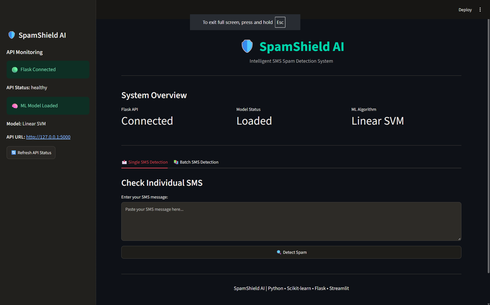
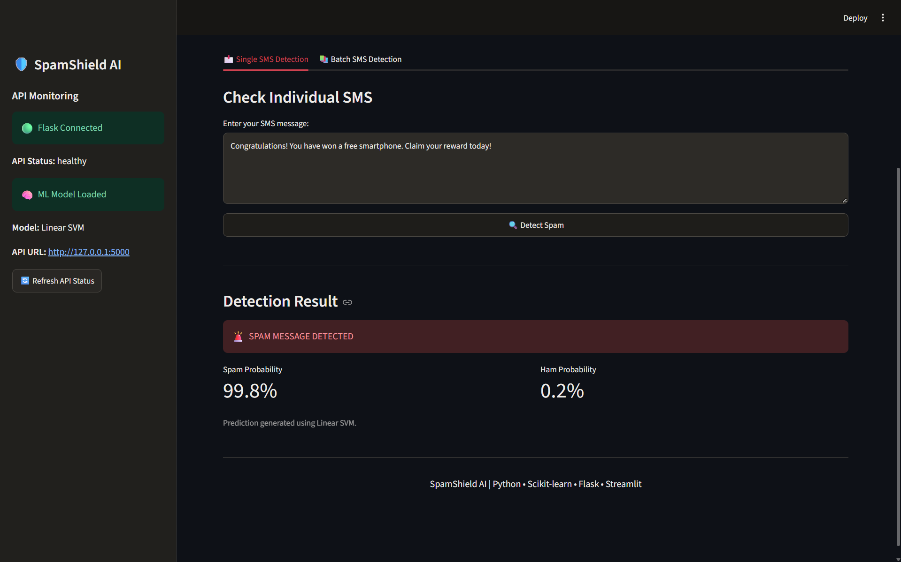
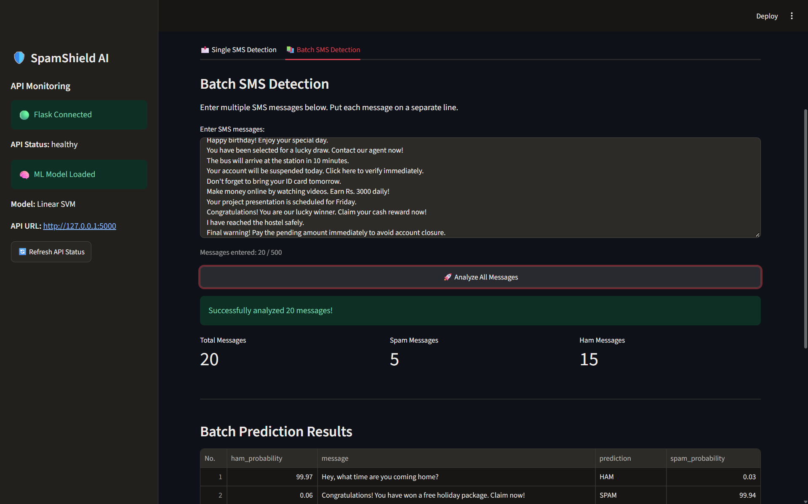

# 🛡️ SpamShield AI

### Intelligent SMS Spam Detection Using Machine Learning & NLP

SpamShield AI is an end-to-end Machine Learning and Natural Language Processing project that identifies whether an SMS message is **Spam** or **Ham (Legitimate)**.

The system uses TF-IDF for text feature extraction and a Linear Support Vector Machine (SVM) classifier to analyze messages and make predictions. It also provides an interactive Streamlit web application and a Flask-based REST API for real-time and batch predictions.

<p align="center">
  <a href="https://spamshield-ai-ml.streamlit.app/">
    
  </a>
  <a href="https://github.com/muralikarthikhugar-ai/SpamShield-AI">
    
  </a>
</p>

---

## 🌐 Live Application

**Try SpamShield AI here:**

https://spamshield-ai-ml.streamlit.app/

The application allows users to:
- Enter an SMS message and check whether it is spam.
- View the prediction and estimated confidence.
- Analyze multiple messages through batch processing.
- Upload CSV files for bulk message analysis.

> Note: The first request may take longer if the free hosting service has been inactive.

---

## 📸 Screenshots

### 1. Application Dashboard



### 2. Single Message Detection



### 3. Batch Message Detection



---

## ✨ Key Features

- **Real-Time SMS Detection:** Classifies individual SMS messages as Spam or Ham.
- **Machine Learning Classification:** Uses a trained Linear SVM model.
- **TF-IDF Feature Extraction:** Converts text messages into numerical features.
- **Confidence Scores:** Displays estimated probabilities for predictions.
- **Batch Prediction:** Processes multiple messages in a single request.
- **CSV Processing:** Supports bulk message analysis using CSV files.
- **REST API:** Provides Flask API endpoints for external integration.
- **Model Comparison:** Evaluates multiple machine learning algorithms before selecting the final model.
- **Cloud Deployment:** Streamlit frontend and Flask API are hosted online.

---

## 🧠 How It Works

SpamShield AI follows a machine learning pipeline to classify SMS messages.

```text
       User Input
           |
           v
    SMS Message
           |
           v
    Text Preprocessing
           |
           v
    TF-IDF Vectorization
           |
           v
    Trained Linear SVM
           |
           v
    Prediction & Probability
           |
           v
     Spam or Ham
           |
           v
    Display Result
```

### 1. Dataset Collection

The project uses the SMS Spam Collection Dataset, which contains SMS messages labeled as:

- **Ham:** Legitimate messages.
- **Spam:** Unwanted or suspicious messages.

The original dataset contains 5,574 messages. The prepared dataset used during model development contained 5,158 records.

### 2. Text Preprocessing

Text data is prepared before it is passed to the machine learning model.

The preprocessing and feature extraction pipeline prepares the message for classification.

### 3. Feature Extraction Using TF-IDF

Machine learning algorithms cannot directly understand raw text.

TF-IDF (Term Frequency-Inverse Document Frequency) converts text into numerical features that represent the importance of words in the messages.

This allows the classifier to identify patterns associated with spam and legitimate messages.

### 4. Model Training

Multiple machine learning algorithms were trained and evaluated.

The models were compared using:
- Accuracy
- Precision
- Recall
- F1-Score
- Confusion Matrix

### 5. Final Prediction

After evaluation, the best-performing model was selected and saved.

The application loads this trained model to classify new SMS messages.

---

## 🤖 Machine Learning Models

Three machine learning algorithms were compared during development.

| Model | Accuracy | Spam Precision | Spam Recall | Spam F1-Score |
|---|---:|---:|---:|---:|
| Multinomial Naive Bayes | 96.32% | 100.00% | 70.31% | 82.57% |
| Logistic Regression | 98.55% | 93.80% | 94.53% | 94.16% |
| **Linear SVM** | **98.93%** | **97.56%** | **93.75%** | **95.62%** |

### Why Linear SVM?

Linear SVM achieved the highest test accuracy and spam F1-score among the three evaluated models.

It was selected as the final model because it provided a strong balance between identifying spam messages and avoiding false spam classifications.

### Final Model

- Algorithm: Linear Support Vector Machine
- Feature Extraction: TF-IDF
- Probability Estimation: Calibrated Classifier
- Saved Model: `spam_model.pkl`

**Important:** The 98.93% accuracy is the result on the held-out test dataset. Actual performance may vary with new messages and real-world data.

---

## 📊 Model Evaluation

The selected model was evaluated using a confusion matrix.

```text
                 Predicted
              Ham       Spam

Actual Ham     901        3

Actual Spam      8      120
```

| Metric | Result |
|---|---:|
| True Negatives | 901 |
| False Positives | 3 |
| False Negatives | 8 |
| True Positives | 120 |

### Evaluation Metrics

- **Accuracy:** Measures the overall percentage of correct predictions.
- **Precision:** Measures how many messages predicted as spam were actually spam.
- **Recall:** Measures how many actual spam messages were correctly detected.
- **F1-Score:** Balances precision and recall.

---

## 🛠️ Technology Stack

| Category | Technologies |
|---|---|
| Programming Language | Python |
| Machine Learning | Scikit-learn |
| NLP & Feature Extraction | TF-IDF |
| ML Algorithm | Linear SVM |
| Probability Calibration | CalibratedClassifierCV |
| Frontend | Streamlit |
| Backend | Flask |
| Data Processing | Pandas, NumPy |
| Model Serialization | Joblib |
| API Server | Gunicorn |
| Version Control | Git & GitHub |
| Frontend Hosting | Streamlit Community Cloud |
| Backend Hosting | Render |

---

## 📂 Project Structure

The main project structure is organized as follows:

```text
SpamShield-AI/
│
├── app.py
├── streamlit_app.py
├── train_model.py
├── requirements.txt
├── README.md
│
├── models/
│   └── spam_model.pkl
│
├── data/
│   └── spam.csv
│
└── screenshots/
    ├── dashboard.png
    ├── single-detection.png
    └── batch-detection.png
```

*Note: This is the documented project layout. Adjust filenames or folders if your actual repository uses different names.*

---

## ⚙️ Installation and Setup

Follow these steps to run SpamShield AI locally.

### Prerequisites

- Python 3.9 or higher
- Git
- pip
- A code editor such as VS Code

### Step 1: Clone the Repository

```bash
git clone https://github.com/muralikarthikhugar-ai/SpamShield-AI.git
```

Navigate to the project directory:

```bash
cd SpamShield-AI
```

### Step 2: Create a Virtual Environment

```bash
python -m venv venv
```

Activate the environment.

**Windows:**

```bash
venv\Scripts\activate
```

**Linux / macOS:**

```bash
source venv/bin/activate
```

### Step 3: Install Dependencies

```bash
pip install -r requirements.txt
```

### Step 4: Run the Flask API

Start the Flask backend:

```bash
python app.py
```

The API will run locally using the configured Flask port.

### Step 5: Run the Streamlit Application

Open another terminal, activate the same virtual environment, and run:

```bash
streamlit run streamlit_app.py
```

The Streamlit application will normally be available at:

```text
http://localhost:8501
```

---

## 🔌 REST API Documentation

SpamShield AI includes a Flask-based REST API for making spam predictions.

### Base API

The deployed backend is hosted on Render.

Set the backend URL in your Streamlit configuration using the `FLASK_API_URL` environment variable or Streamlit secrets.

### Available Endpoints

| Method | Endpoint | Description |
|---|---|---|
| GET | `/` | Returns API information |
| GET | `/health` | Checks API and model status |
| POST | `/predict` | Predicts a single SMS message |
| POST | `/predict/batch` | Predicts multiple SMS messages |

### 1. API Information

**Request:**

```http
GET /
```

Returns basic API information, including project name, model, version, and status.

### 2. Health Check

**Request:**

```http
GET /health
```

Checks whether the API is running and the machine learning model is loaded.

### 3. Single Message Prediction

**Request:**

```http
POST /predict
Content-Type: application/json
```

**Request Body:**

```json
{
  "message": "Congratulations! You have won a free prize. Claim now!"
}
```

The API processes the message and returns a spam classification with prediction information.

### 4. Batch Message Prediction

**Request:**

```http
POST /predict/batch
Content-Type: application/json
```

**Request Body:**

```json
{
  "messages": [
    "Hey, are we meeting today?",
    "Congratulations! You won a free gift. Claim now!",
    "Your appointment is confirmed."
  ]
}
```

The API returns prediction results for the submitted messages.

**Batch limit:** Up to 500 messages per request.

---

## 📚 Dataset Information

**Dataset:** SMS Spam Collection Dataset

**Source:** UCI Machine Learning Repository / Kaggle

The dataset contains two categories:

| Label | Description |
|---|---|
| Ham | Legitimate SMS messages |
| Spam | Unwanted or suspicious SMS messages |

The original dataset contains 5,574 messages. The prepared dataset used in this project contained 5,158 records.

The dataset was used for training, testing, and evaluating the machine learning models.

---

## 🧪 Example Predictions

### Example 1: Spam Message

**Input:**

```text
Congratulations! You have won a free prize.
Click here to claim your reward now!
```

**Expected classification:** Spam

### Example 2: Legitimate Message

**Input:**

```text
Hey, are we still meeting at 6 PM today?
```

**Expected classification:** Ham

*These are illustrative examples. Actual predictions depend on the trained model.*

---

## 🚀 Deployment

SpamShield AI is deployed using two hosting platforms.

| Component | Platform |
|---|---|
| Streamlit Frontend | Streamlit Community Cloud |
| Flask Backend API | Render |
| Source Code | GitHub |

### Live Links

- **Web Application:** https://spamshield-ai-ml.streamlit.app/
- **GitHub Repository:** https://github.com/muralikarthikhugar-ai/SpamShield-AI

The Streamlit frontend communicates with the Flask API to get prediction results.

---

## 🔮 Future Enhancements

Some possible improvements for future versions include:

- User feedback collection for incorrect predictions.
- Learning from verified user corrections.
- Automated model retraining.
- Multilingual spam message detection.
- Improved detection of suspicious URLs and phishing messages.
- Model performance monitoring.
- Prediction history and analytics dashboard.
- Better handling of new and previously unseen spam patterns.

---

## ⚠️ Limitations

- The current model is trained primarily on the SMS dataset used during development.
- Performance may vary on messages containing languages or patterns not represented in the training data.
- Prediction confidence is an estimate, not a guarantee that a message is safe.
- The system should be used as a screening tool rather than the sole basis for deciding whether a message is legitimate.
- New spam patterns may require additional verified training data and model updates.

---

## 📖 Key Learnings

Through this project, I gained practical experience in:

- Understanding and preparing text datasets.
- Applying Natural Language Processing concepts.
- Converting text into numerical features using TF-IDF.
- Training and comparing machine learning algorithms.
- Evaluating models using accuracy, precision, recall, and F1-score.
- Understanding confusion matrices and classification errors.
- Saving and loading trained machine learning models.
- Integrating a machine learning model with Flask.
- Building an interactive application using Streamlit.
- Creating REST API endpoints for predictions.
- Deploying a machine learning application using cloud platforms.
- Managing project source code using Git and GitHub.

---

## 👨‍💻 Author

**Murali Karthik**

Data Science Trainee | Python & Machine Learning

Interested in:
- Machine Learning
- Artificial Intelligence
- Natural Language Processing
- Python Development
- Generative AI

### Connect With Me

- **GitHub:** https://github.com/muralikarthikhugar-ai
- **LinkedIn:** Add your LinkedIn profile URL
- **Portfolio:** Add your portfolio URL

---

## 📄 License

This project is intended for educational and portfolio purposes.

Add a `LICENSE` file to the repository if you want to distribute the project under a specific open-source license.

---

## ⭐ Support

If you find this project interesting, consider giving the repository a star on GitHub.

**SpamShield AI — Making SMS communication safer through Machine Learning.**