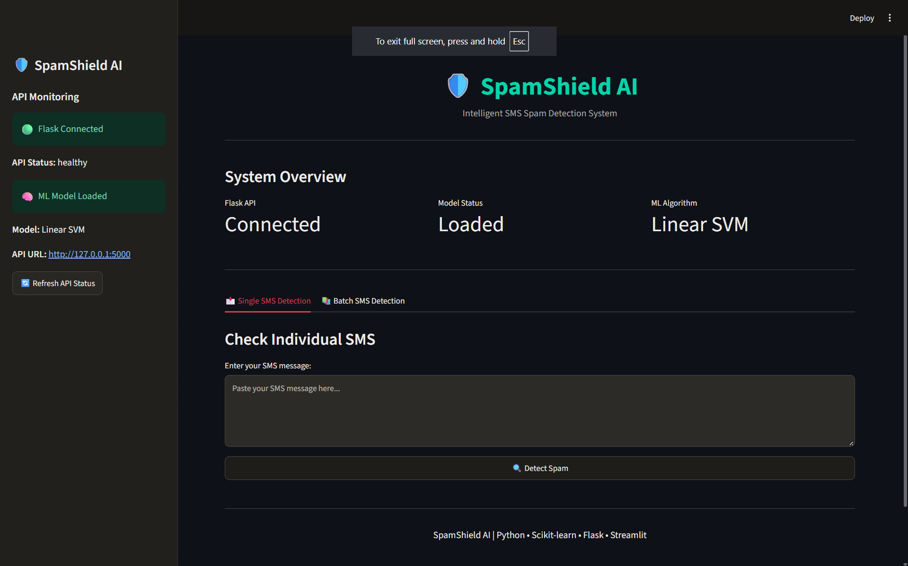
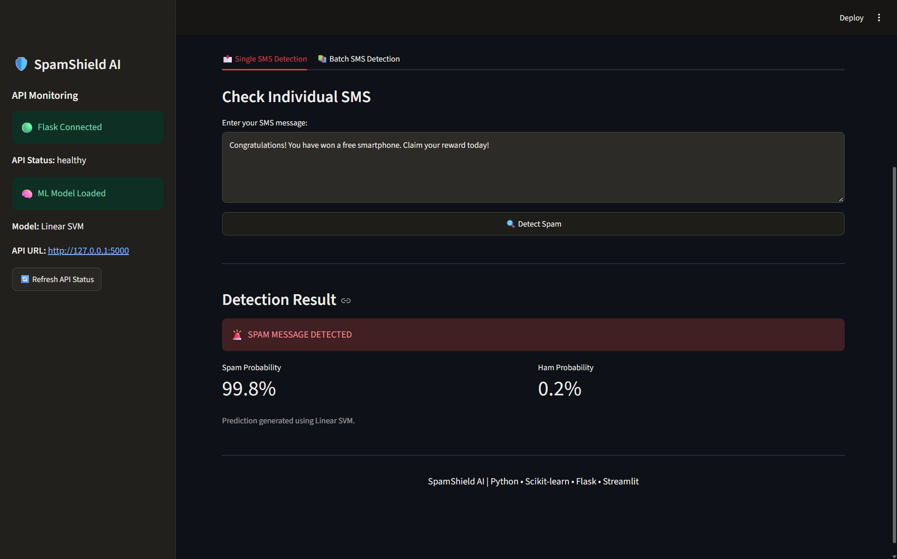
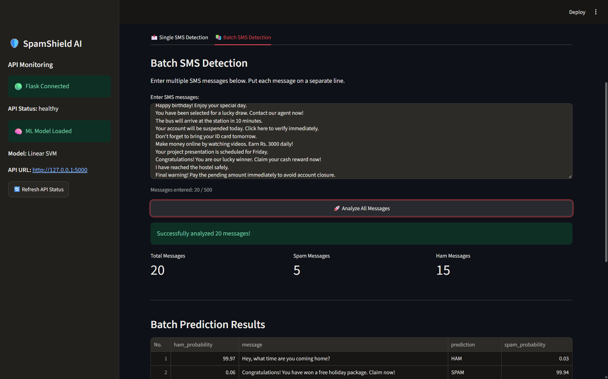

<div align="center">

# 🛡️ SpamShield AI

### Intelligent SMS Spam Detection Using Machine Learning

**Detect. Analyse. Protect.**

A machine learning-powered SMS classification system that identifies suspicious and legitimate text messages using Natural Language Processing and supervised learning.

<br/>


</div>

---

## 📌 About the Project

**SpamShield AI** is a machine learning-based SMS spam detection application developed using Python.

The system analyses the content of SMS messages and classifies them into two categories:

- 🟢 **HAM** – Legitimate or normal messages.
- 🔴 **SPAM** – Unwanted, suspicious or potentially fraudulent messages.

The application uses TF-IDF for text feature extraction and compares multiple machine learning algorithms to select the best-performing model.

A Flask REST API handles predictions, while Streamlit provides an interactive user interface.

## ✨ Key Features

| Feature | Description |
|---|---|
| 📩 Single SMS Detection | Analyse one message at a time |
| 📚 Batch Detection | Analyse multiple messages together |
| 🧠 ML Classification | Uses a trained Linear SVM model |
| 📊 Probability Scores | Displays estimated HAM and SPAM probabilities |
| 🔌 REST API | Flask-based prediction endpoints |
| 💻 Interactive Dashboard | User-friendly Streamlit interface |
| ❤️ API Health Monitoring | Displays Flask and model connection status |
| 📥 CSV Export | Download batch prediction results |

---

## 🖥️ Application Preview

<!-- Add your screenshots in a screenshots/ folder -->

### Main Dashboard


### Single SMS Detection


### Batch SMS Detection



---

## ⚙️ Machine Learning Approach

The project follows a complete machine learning workflow.

```text
SMS Dataset
     │
     ▼
Data Cleaning
     │
     ▼
Text Preprocessing
     │
     ▼
TF-IDF Vectorization
     │
     ▼
Model Training
     │
     ▼
Model Comparison
     │
     ▼
Best Model Selection
     │
     ▼
Flask REST API
     │
     ▼
Streamlit Dashboard
     │
     ▼
HAM / SPAM Prediction
```

### Algorithms Compared

Three classification algorithms were trained and evaluated.

| Algorithm | Accuracy | Spam Precision | Spam Recall | Spam F1 |
|---|---:|---:|---:|---:|
| Multinomial Naive Bayes | 96.32% | 100.00% | 70.31% | 82.57% |
| Logistic Regression | 98.55% | 93.80% | 94.53% | 94.16% |
| **Linear SVM** | **98.93%** | **97.56%** | **93.75%** | **95.62%** |

### Selected Model: Linear SVM

Linear SVM was selected because it achieved the highest F1-score for the spam class among the evaluated models.

The final pipeline includes:

- TF-IDF Vectorizer
- Linear Support Vector Classifier
- CalibratedClassifierCV for estimated class probabilities

### Model Evaluation

**Test-set Accuracy: 98.93%**

Confusion Matrix:

| | Predicted HAM | Predicted SPAM |
|---|---:|---:|
| Actual HAM | 901 | 3 |
| Actual SPAM | 8 | 120 |

The evaluation was performed using a stratified 80:20 train-test split.

---

## 🛠️ Technology Stack

| Technology | Usage |
|---|---|
| Python | Core development |
| Pandas | Data processing |
| NumPy | Numerical operations |
| Scikit-learn | Machine learning |
| TF-IDF | Text feature extraction |
| Matplotlib | Data visualization |
| Seaborn | Exploratory data analysis |
| Flask | Backend REST API |
| Streamlit | Frontend dashboard |
| Joblib | Model serialization |
| Postman | API testing |
| uv | Dependency management |

---

## 📂 Project Structure

```text
SpamShield-AI/
│
├── data/
│   └── .gitkeep
│
├── models/
│   ├── spam_model.pkl
│   └── metrics.json
│
├── screenshots/
│   ├── dashboard.png
│   ├── single-detection.png
│   └── batch-detection.png
│
├── app.py
├── streamlit_app.py
├── train.py
├── eda.py
│
├── requirements.txt
├── pyproject.toml
├── uv.lock
├── .gitignore
└── README.md
```

> The original CSV datasets are intentionally not included in this GitHub repository. Download instructions are provided below.

---

## 📚 Dataset Information

This project uses the **SMS Spam Collection Dataset**.

The dataset contains 5,574 English SMS messages labelled as either HAM or SPAM.

### Download the Dataset

The original dataset is available from these sources:

| Source | Link |
|---|---|
| UCI Machine Learning Repository | [Download Dataset](https://archive.ics.uci.edu/dataset/228/sms+spam+collection) |
| Kaggle | [View Dataset](https://www.kaggle.com/datasets/uciml/sms-spam-collection-dataset) |

**Primary source:** UCI Machine Learning Repository.

### Dataset Setup

After downloading the dataset:

1. Extract the downloaded archive.
2. Place the original CSV file in the `data/` directory.
3. Ensure that the filename matches what your training code expects (`spam.csv`).
4. Run the data cleaning and training scripts if you want to reproduce the model.

```text
data/
└── spam.csv
```

The cleaned dataset is generated locally during the data preparation process.

### Dataset Attribution

Dataset: SMS Spam Collection

Creators: Tiago Almeida and José María Gómez Hidalgo.

Citation:

Almeida, T. & Hidalgo, J. (2011). SMS Spam Collection [Dataset]. UCI Machine Learning Repository.

DOI: [10.24432/C5CC84](https://doi.org/10.24432/C5CC84)

Licence: Creative Commons Attribution 4.0 International (CC BY 4.0).

---

## 🚀 Installation and Setup

### Prerequisites

Install the following:

- Python 3.10 or later
- Git
- uv package manager
- VS Code (recommended)

### Step 1: Clone the Repository

```bash
git clone https://github.com/muralikarthikhugar-ai/SpamShield-AI.git
```

```bash
cd SpamShield-AI
```

### Step 2: Create Virtual Environment

```bash
uv venv
```

### Step 3: Install Dependencies

```bash
uv sync
```

Alternatively, use:

```bash
uv pip install -r requirements.txt
```

Use the method matching the dependency files in the repository.

### Step 4: Start Flask Backend

Open the first terminal:

```bash
uv run python app.py
```

Flask API:

```text
http://127.0.0.1:5000
```

### Step 5: Start Streamlit Frontend

Open a second terminal:

```bash
uv run python -m streamlit run streamlit_app.py
```

Open the application:

```text
http://localhost:8501
```

**Important:** Start Flask before using Streamlit. Keep both terminals running.

> The repository includes the trained model, so you do not need to download the dataset or retrain the model just to run the application. The dataset is needed when reproducing the training process.

---

## 🔌 REST API Documentation

The Flask backend exposes four endpoints.

| HTTP Method | Endpoint | Purpose |
|---|---|---|
| GET | `/` | API information |
| GET | `/health` | Check backend and model health |
| POST | `/predict` | Predict one SMS |
| POST | `/predict/batch` | Predict multiple SMS messages |

### 1. Health Check

```http
GET http://127.0.0.1:5000/health
```

### 2. Single Message Prediction

```http
POST http://127.0.0.1:5000/predict
```

Request body:

```json
{
  "message": "Congratulations! You won a free gift. Claim now!"
}
```

### 3. Batch Message Prediction

```http
POST http://127.0.0.1:5000/predict/batch
```

Request body:

```json
{
  "messages": [
    "Hey, are you coming to college tomorrow?",
    "Congratulations! You won a free gift. Claim now!",
    "Please bring your laptop to class."
  ]
}
```

The API returns a prediction and estimated spam and ham probabilities for each message.

---

## 🔮 Future Enhancements

- Multilingual SMS spam detection.
- Support for regional languages.
- Advanced NLP and transformer-based models.
- Phishing URL analysis.
- Prediction history and analytics dashboard.
- Cloud deployment.
- Improved performance on new and unseen SMS messages.

---

## ⚠️ Limitations

- Model predictions depend on the training data and learned text patterns.
- New spam techniques may not be detected correctly.
- The model cannot verify the identity of the sender or the authenticity of a link.
- Probability scores are estimates, not guarantees.
- This application is an educational machine learning project, not a complete fraud-prevention system.

---

## 👨‍💻 Author

**Murali Karthik**

Data Science | Machine Learning | Python

---

<div align="center">

### 🛡️ SpamShield AI

**Smarter SMS Classification Through Machine Learning**

If you find this project interesting, consider giving it a ⭐ on GitHub!

</div>
